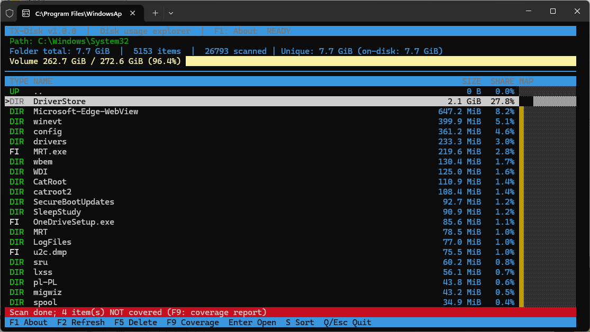

# TX-Disk

<p align="center">
  <a href="https://github.com/polsoft-IT"></a>
  <a href="https://github.com/polsoft-IT"></a>
  <a href="https://github.com/polsoft-IT"></a>
  <a href="https://github.com/polsoft-IT"></a>
  <a href="https://github.com/polsoft-IT"></a>
</p>

<p align="center">
  <strong>Fast, interactive, metadata-driven disk usage analyzer and directory browser for terminal power users.</strong>
</p>

---

## 📸 Screenshot

<p align="center">
  
</p>

---

## 📖 Overview

**TX-Disk** is an interactive Terminal User Interface (TUI) tool designed for rapid inspection and navigation of disk space consumption. Built with pure Python and `curses`, it scans directory hierarchies asynchronously, computes true allocated and logical disk space, detects sparse files and hardlink duplicates, and visualizes space distribution with proportional visual bars.

Unlike heavy graphical utilities, TX-Disk is lightweight, operates completely within your terminal, and executes non-blocking background metadata scans without ever reading file contents into memory.

---

## ✨ Features

- ⚡ **High-Performance Metadata Scan**: Leverages `os.scandir` to retrieve filesystem `stat` information without opening file descriptors, guaranteeing optimal scan velocity.
- 🧵 **Asynchronous Background Processing**: Scans execute on dedicated daemon threads, keeping the UI responsive with real-time scanned entry counters.
- 🔗 **Smart Hardlink Accounting**: Tracks unique `(device, inode)` pairs to avoid double-counting storage for hardlinks, reporting exact bytes saved.
- 💾 **Sparse File Detection**: Compares logical file sizes against physically allocated filesystem blocks (`st_blocks`) to identify sparse files and show disk savings.
- 📊 **Visual Storage Distribution**:
  - Overall volume usage gauge showing capacity, occupied space, and percentage.
  - Per-item proportional ASCII/Unicode block share bars (`█░`).
- 📁 **Seamless Navigation**: Drill down into directories with `Enter` and navigate back with `..` effortlessly.
- 🛡️ **Comprehensive Coverage Reporting**: Access the F9 Coverage Report to review unscannable paths or permission errors instead of silently skipping them.
- 🗑️ **Safe File Deletion**: Permanent deletion with a full-screen confirmation prompt (`F5`).
- 🔄 **Dynamic Sorting**: Instant toggle between size-descending and alphabetical sorting (`S`).

---

## 📋 Requirements

- **Python**: 3.8 or newer
- **Operating System**:
  - **Linux / macOS**: Native `curses` included with standard Python.
  - **Windows**: Requires `windows-curses` for console terminal emulation.

---

## 🚀 Installation

### 1. Clone or Download the Repository

```bash
git clone https://github.com/polsoft-IT/TX-Disk.git
cd TX-Disk
```

### 2. Install Dependencies (Windows Only)

If running on Windows, install `windows-curses`:

```bash
pip install windows-curses
```

*No external third-party dependencies are required on Linux or macOS.*

---

## 💻 Usage

Run TX-Disk from the command line:

```bash
# Analyze the current directory
python TX-Disk_1.0.py

# Analyze a specific path or drive
python TX-Disk_1.0.py /var/log
python TX-Disk_1.0.py C:\Users
python TX-Disk_1.0.py ~/Documents
```

---

## ⌨️ Keyboard Shortcuts

| Key | Action | Description |
| :--- | :--- | :--- |
| <kbd>↑</kbd> / <kbd>↓</kbd> | **Navigate** | Move cursor up / down |
| <kbd>Page Up</kbd> / <kbd>Page Down</kbd> | **Page Scroll** | Scroll list by a full page |
| <kbd>Home</kbd> / <kbd>End</kbd> | **Jump** | Jump directly to top or bottom of list |
| <kbd>Enter</kbd> | **Drill Down** | Open selected directory or return via `..` |
| <kbd>S</kbd> | **Toggle Sort** | Switch sorting between size (descending) and name |
| <kbd>F1</kbd> | **About** | Show version, author, and license information |
| <kbd>F2</kbd> | **Refresh** | Restart scanning the active directory |
| <kbd>F5</kbd> | **Delete** | Delete highlighted file/directory (with confirmation) |
| <kbd>F9</kbd> | **Coverage Report** | View unscanned/inaccessible paths and error reasons |
| <kbd>Q</kbd> / <kbd>Esc</kbd> | **Quit** | Exit TX-Disk |

---

## 🏷️ Indicators & Flags

In the item listing, the type column displays badges and status flags:

- `DIR` : Directory
- `FILE` : Regular file
- `UP` : Parent directory (`..`)
- `L` : Hardlink duplicate (shares inode with already scanned file)
- `S` : Sparse file (logical size is significantly larger than physical allocation)

---

## 🏢 Author & Contact

- **Application**: TX-Disk v1.0.0
- **Author**: Sebastian Januchowski
- **Company**: polsoft.ITS(TM)
- **Email**: [polsoft.its@mail.com](mailto:polsoft.its@mail.com)
- **GitHub**: [https://github.com/polsoft-IT](https://github.com/polsoft-IT)

---

## 📄 License

Copyright &copy; 2026 polsoft.ITS(TM). All rights reserved.
